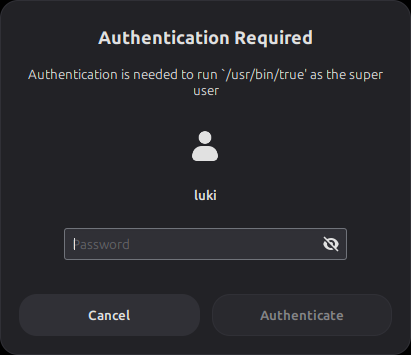
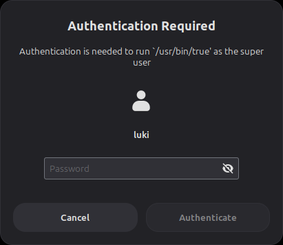

# cinnamon-polkit-agent

A standalone polkit authentication agent that recreates **Cinnamon's built-in
"Authentication Required" dialog**, for window managers that aren't Cinnamon
(I use it under driftwm, a Wayland infinite-canvas WM).

Cinnamon's own agent lives inside the Cinnamon shell
(`/usr/share/cinnamon/js/ui/polkitAuthenticationAgent.js`) and can't run anywhere
else. This project reimplements the same flow and draws a replica of the dialog.

| Cinnamon (original) | This agent |
|---|---|
|  |  |

## How it was matched

The reference was rendered by a real, nested Cinnamon 6.6 session (Xephyr). The
`AuthenticationDialog` was opened via `org.Cinnamon.Eval` and captured with
Cinnamon's own screenshot D-Bus method. Every actor's allocation was dumped from
the live St tree, and the colors come from the Mint-Y-Dark-Aqua `cinnamon.css`.
`render.py` draws each element at those exact coordinates with cairo and Pango.

A pixel diff against the original (411×355 dialog):

- frame, background, borders, rounded corners and layout: **0 differing pixels**
- overall: **95.5 % identical**. The remaining differences are text
  antialiasing, mostly under 20/255 per channel. Cinnamon draws glyphs through
  Cogl's GL glyph cache, which cairo can't reproduce bit for bit.

## How it works

- `agent.py` registers with polkitd over D-Bus (`RegisterAuthenticationAgent`)
  and implements `org.freedesktop.PolicyKit1.AuthenticationAgent` directly.
  It doesn't use a `PolkitAgent.Listener` subclass, because PyGObject's async
  vfunc wrapper crashes on completion.
- Authentication itself goes through `PolkitAgent.Session` (the PAM helper). It
  follows Cinnamon's flow, including "Sorry, that didn't work. Please try again."
  and re-prompting.
- The dialog is a fullscreen GTK3 window with a `rgba(0,0,0,0.4)` lightbox,
  like Cinnamon's modal dialogs.

## Requirements

Python 3, PyGObject, GTK 3, `gir1.2-polkit-1.0`, the Ubuntu font, and the
`xsi-*` symbolic icons (shipped with XApp/Cinnamon in `hicolor`).

## Usage

Stop any other polkit agent (only one can be registered per session), then run:

```sh
./agent.py
```

To start it with your session, add it to your WM's autostart. For driftwm:

```toml
autostart = ["/path/to/cinnamon-polkit-agent/agent.py", ...]
```

Test it with `pkexec true`.

## Limitations

- The look is fixed to Mint-Y-Dark-Aqua at scale 1. Other themes and HiDPI
  aren't handled.
- When several admin users are allowed, it picks you (or the first one). There's
  no user-switch menu.
- It shows the generic avatar icon, not your account picture, and it has no
  open/close fade animation.
- On Wayland it uses wlr-layer-shell (via `libgtk-layer-shell`, loaded with ctypes) to sit on the overlay layer with exclusive keyboard focus. Without layer-shell it falls back to a fullscreen window, which some compositors may not focus.

## License

GPL-2.0-or-later. The authentication flow follows Cinnamon's
`polkitAuthenticationAgent.js`, which is GPL-2.0-or-later.
